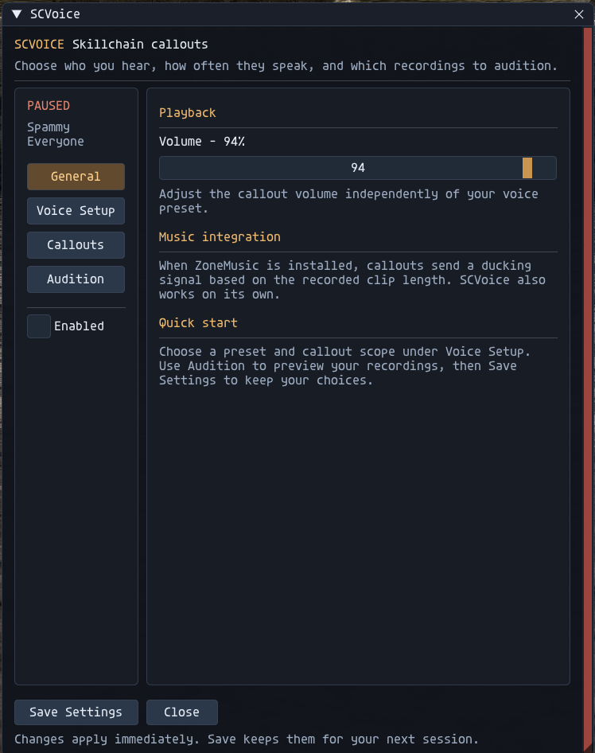
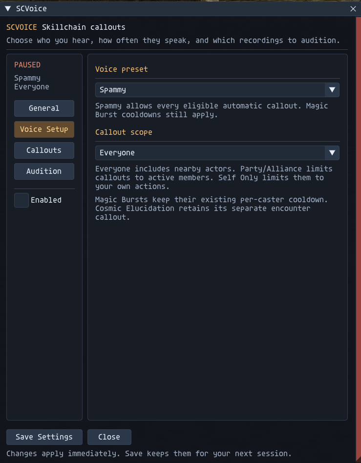
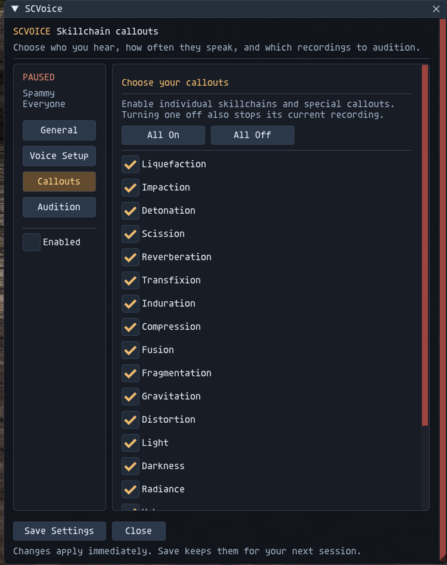
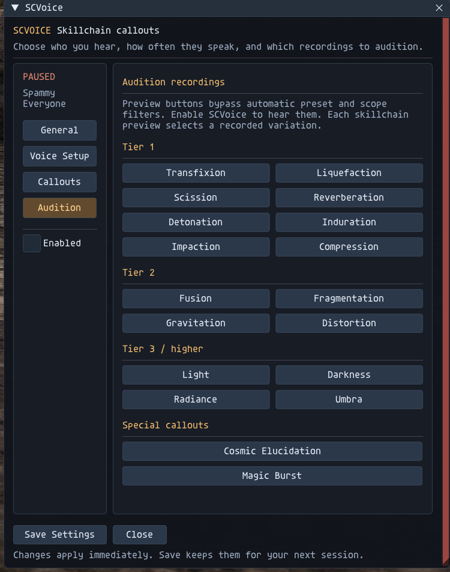

# SCVoice 1.4

## Download

**[Download SCVoice-1.4-addon.zip from GitHub Releases](https://github.com/OpMoonRise2/SCVoice/releases/latest).** GitHub is the only download location for the addon. The release ZIP contains the addon code and documentation, and it extracts straight into your Ashita folder.

The voice recordings are optional and separate. The [SCVoice Sound Pack on Nexus Mods](https://www.nexusmods.com/finalfantasy11/mods/40) contains audio only, with no addon code. You may instead supply your own recordings using the filenames below. Missing recordings cannot play.

Skillchain and Magic Burst voice callouts for Ashita v4, with selectable frequency, scope filters, volume control and in-menu previews.

## New in 1.4

The redesigned navy-and-gold GUI matches BeastVoice, with a resizable window, wrapped help text, scrolling content and separate General, Voice Setup, Callouts and Audition pages. Each of the 16 skillchains, Magic Burst and Cosmic Elucidation has its own saved switch. All On/Off controls are included; disabling a callout stops its current SCVoice-owned recording. Switches apply to both automatic playback and audition. Missing new settings default to enabled.

## Screenshots

## Features

- Two recorded variants for each of 16 configured skillchains, from Liquefaction and Scission through Light, Darkness, Radiance and Umbra.
- Three numbered Magic Burst variants, plus the legacy single-file fallback.
- A separate Cosmic Elucidation recording.
- Muted, Occasional, Balanced and Spammy presets.
- Everyone, Party/Alliance and Self Only callout scopes.
- Per-caster Magic Burst cooldowns and saved character settings.
- Optional ZoneMusic ducking through the shared voice signal file. ZoneMusic is not required for the callouts themselves.

## Installation

Requires Ashita v4 on Windows. The addon uses Ashita's bundled common, chat, FFI, ImGui and settings modules, plus the Windows MCI audio player.

1. Download `SCVoice-1.4-addon.zip` from [GitHub Releases](https://github.com/OpMoonRise2/SCVoice/releases/latest) and extract it into your Ashita folder. It creates `addons/scvoice/`.
2. Optional: extract the SCVoice Sound Pack from Nexus Mods into your Ashita folder. It adds the 37 MP3 recordings under `addons/scvoice/sounds/`. You can supply your own recordings there instead.
3. Run `/addon load scvoice`. Open the settings window with `/sc` or `/scvoice`.
4. Choose your volume, preset and callout scope, then click **Save Settings**.

For an update, preserve your existing addon folder outside the install and retain personal settings under Ashita's configuration directory. Reload with `/addon reload scvoice`. To uninstall, unload the addon and remove its folder; original native audio files are not replaced.

## Adding recordings

Skillchain files use `sc_<lowercase_name><number>.mp3`, such as `sc_light1.mp3` and `sc_light2.mp3`. Each configured chain has an explicit `count` in `SC_DATA`; update that count when adding more numbered variants.

Magic Burst files use `magic_burst1.mp3`, `magic_burst2.mp3`, and so on. Numbered variants must be consecutive starting at 1; discovery stops at the first missing number. With none present, the addon uses `magic_burst.mp3`. Cosmic Elucidation uses `sc_cosmic_elucidation.mp3`.

Use MP3 files. The duration estimate assumes constant bitrate; the supplied recordings are checked separately in the prepared asset package. Source-only users must supply the corresponding voice assets before callouts can be heard.

## Playback behavior

The current parser reads the configured skillchain property from closing weapon-skill action packets. Magic Burst and Cosmic Elucidation follow separate message paths. It does not provide a general parser for every possible spell-created chain or multi-target action.

A new skillchain replaces the previous skillchain callout. Magic Burst and Cosmic Elucidation use separate sound slots. Numbered variants are randomly selected; a no-repeat cycle is not implemented. Test buttons bypass the preset rate gate, but still require the addon to be enabled.

## How it works

SCVoice only plays recordings for results the game already reports. It does not change anything the server sees, and it does not play the game for you.

- **Packets.** It reads incoming `0x028` (action) packets. A closing weapon skill's skillchain property selects the skillchain callout. Message 252 (Magic Burst) and message 302 (Cosmic Elucidation) select those callouts. These are the same results the chat log prints. The scope filter (Everyone, Party/Alliance, Self Only) uses your party list from Ashita's memory manager. It sends no packets, injects none, and never blocks or modifies one.
- **Timing.** A callout plays after the skillchain or burst has already happened. It never predicts or times a skillchain or burst window.
- **Audio and files.** Playback uses the Windows MCI player (`winmm.dll`). It writes its settings and `voice_duck_signal.txt` (optional ZoneMusic ducking), and reads recordings from `sounds/`.
- **Commands.** `/sc` and `/scvoice` toggle the GUI; the handler blocks only the addon's own slash commands.

It queues no game commands, creates no macros and automates nothing.

## Source and authorship

Original author: **MoonRise (Eldorin)**. Author credit is retained. This preparation does not assign a new license or change the runtime version.

See `MAINTENANCE.md` for source responsibilities and verification requirements. Personal configuration, runtime signals, backups and local recording paths are excluded from this repository.
